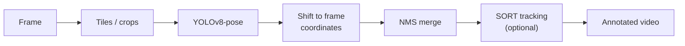

# small-person-pose-yolov8

Experiments for **detecting small or distant people and estimating their pose in high-resolution video** with YOLOv8.
On a full high-resolution frame, far-away people shrink to a few pixels after the model resizes the image. These scripts work around that by running the model on **tiles** (sliding windows) or on **dynamic crops** around each person, then mapping the results back to the original frame.

## Approaches

| Script | Approach | Output |
|---|---|---|
| `sliding_window_pose.py` | Splits each frame into overlapping tiles, runs YOLOv8-pose on each tile, shifts boxes and keypoints back to frame coordinates and merges duplicates with NMS (IoU 0.5). | boxes + keypoints |
| `sliding_window_pose_batch.py` | Same as above, but sends the tiles to the GPU in batches of 16. | boxes + keypoints |
| `sliding_window_pose_sort.py` | Batched sliding window + [SORT](https://github.com/abewley/sort) tracking, which gives each person a persistent ID. | boxes + keypoints + track IDs |
| `dynamic_crop_pose.py` | Two stages: YOLOv8x detects people on the full frame (`imgsz=1280`), then YOLOv8-pose runs on a padded crop (50 px) around each person and the keypoints are put back into the frame. | boxes + keypoints |
| `sahi_sliced_detection.py` | Baseline with [SAHI](https://github.com/obss/sahi) sliced inference (512 × 512 slices, 20 % overlap). | boxes only |



## Installation

Requires Python 3.9+ and an NVIDIA GPU with CUDA (see *Notes*).

```bash
python -m venv .venv
# Windows
.venv\Scripts\activate
# macOS / Linux
source .venv/bin/activate

# first install the PyTorch build that matches your CUDA version:
# https://pytorch.org/get-started/locally/
pip install -r requirements.txt
```

YOLOv8 weights (`yolov8n-pose.pt`, `yolov8x.pt`) are downloaded automatically by Ultralytics on first run.

## Usage

```bash
# sliding window
python sliding_window_pose.py --source video.mp4 --output out.mp4 --window-size 640 --overlap 0.2

# sliding window, batched
python sliding_window_pose_batch.py --source video.mp4 --output out.mp4

# sliding window, batched + SORT tracking
python sliding_window_pose_sort.py --source video.mp4 --output out.mp4

# dynamic crop (detector + pose model)
python dynamic_crop_pose.py --source video.mp4 --output out.mp4 --det-weights yolov8x.pt --pose-weights yolov8n-pose.pt

# SAHI baseline (--view-img shows the frames, --save-img writes the video)
python sahi_sliced_detection.py --source video.mp4 --save-img
```

### Arguments of the sliding-window scripts

| Argument | Default | Description |
|---|---|---|
| `--source` | *(required)* | input video |
| `--output` | `processed_video.mp4` | output video |
| `--weights` | `yolov8n-pose.pt` | YOLOv8 pose weights |
| `--window-size` | `640` | tile size in pixels |
| `--overlap` | `0.2` | overlap between tiles (0–1) |

## Notes and limitations

These are research scripts, not a packaged library.

- **The frame range is fixed in the code.** All scripts start at frame 500. The sliding-window and SAHI scripts process 100 frames, and `dynamic_crop_pose.py` processes 300 frames (500–800). To change this, edit `cap.set(cv2.CAP_PROP_POS_FRAMES, 500)` and the `frame_number ==` check.
- **A GPU is assumed.** Inference uses `device=0`, and `dynamic_crop_pose.py` creates tensors on `cuda:0`.
- `sliding_window_pose_sort.py` overwrites `t.jpg` with the latest annotated frame (debug output).
- `sahi_sliced_detection.py` calls `download_yolov8s_model()`, which saves the YOLOv8s **detection** model as `models/<weights>` when that file does not exist yet. In that case it draws person boxes only, without keypoints. The video is saved to `ultralytics_results_with_pose/exp*/` only when `--save-img` is passed.

## Project structure

```
sliding_window_pose.py         # sliding-window pose estimation
sliding_window_pose_batch.py   # batched sliding window
sliding_window_pose_sort.py    # batched sliding window + SORT
dynamic_crop_pose.py           # detector + dynamic crop + pose
sahi_sliced_detection.py       # SAHI baseline
sort.py                        # SORT tracker (third-party, see below)
requirements.txt
```

## Credits and license

- `sort.py` is **SORT: A Simple, Online and Realtime Tracker** by Alex Bewley (GPL-3.0), included without changes.
- Uses [Ultralytics YOLOv8](https://github.com/ultralytics/ultralytics) (AGPL-3.0) and [SAHI](https://github.com/obss/sahi) (MIT).

This repository is released under the [AGPL-3.0](LICENSE).
